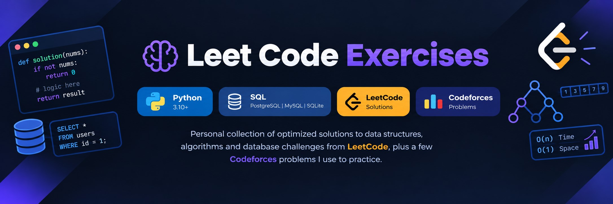

# 🧠 Leet Code Exercises




Personal collection of optimized solutions to data structures, algorithms, and database challenges from **LeetCode**, plus a few **Codeforces** problems I use to practice.

## 🧐 About

This is my personal repo for practicing and documenting solutions to algorithmic and database problems. I use it to keep track of what I have solved, revisit old approaches, and compare optimizations over time.

As a backend-focused software engineer, I focus on:

- **Complexity analysis**: time and space trade-offs
- **Advanced data structures**: trees, heaps, graphs, tries, segment trees
- **Relational database querying**: joins, window functions, CTEs
- **Algorithmic paradigms**: Dynamic Programming, Greedy, Graph Traversal, Divide & Conquer

Each solution is my own work, written for clarity first and optimization second.

## 📁 Repository Architecture

The repo is organized by platform, with each problem isolated in its own directory:

```text
leet-code-exercises/
├── LeetCode/
│   ├── [Problem-Number-Name]/
│   │   ├── solution.py         # Optimized algorithmic solution
│   │   ├── query.sql           # SQL solution (where applicable)
│   │   └── README.md           # Problem link and algorithmic breakdown
│   └── ...
├── Codeforces/
│   ├── [Problem-ID-Name]/
│   │   ├── solution.py         # Solution source code
│   │   └── README.md           # Test cases and logic applied
│   └── ...
├── LICENSE                     # MIT License
└── README.md                   # Main index
```

Each problem directory follows the same convention:

| File          | Purpose                                                |
| :------------ | :----------------------------------------------------- |
| `solution.py` | Source code of the optimized solution                  |
| `query.sql`   | SQL query (only for database problems)                 |
| `README.md`   | Problem link, approach, complexity analysis, and notes |

## 🏁 Getting Started

These instructions are for running any solution locally.

### Prerequisites

| Requirement | Version | Purpose                                  |
| :---------- | :------ | :--------------------------------------- |
| Python      | ≥ 3.10  | Running algorithmic solutions            |
| PostgreSQL  | any     | Verifying SQL problems (or MySQL/SQLite) |
| Git         | any     | Cloning the repository                   |

### Installation

Clone the repository:

```bash
git clone https://github.com/cris0d3v/leet-code-exercises.git
cd leet-code-exercises
```

No external dependencies are required for the Python solutions. They rely on the standard library only.

## 🎈 Usage

Navigate into any platform and problem directory to inspect the implementation and read the problem-specific breakdown:

```bash
cd LeetCode/[Problem-Number-Name]
python solution.py
```

For SQL challenges, run the query against your local database:

```bash
psql -U <user> -d <database> -f query.sql
```

Or, using SQLite:

```bash
sqlite3 <database>.db < query.sql
```

## ⛏️ Built Using

- [Python](https://www.python.org/): primary language for algorithmic solutions
- [SQL](https://en.wikipedia.org/wiki/SQL): primary language for database challenges
- [LeetCode](https://leetcode.com/): main platform source
- [Codeforces](https://codeforces.com/): secondary platform source

## ✍️ Author

- [@cris0d3v](https://github.com/cris0d3v): initial work and maintenance
